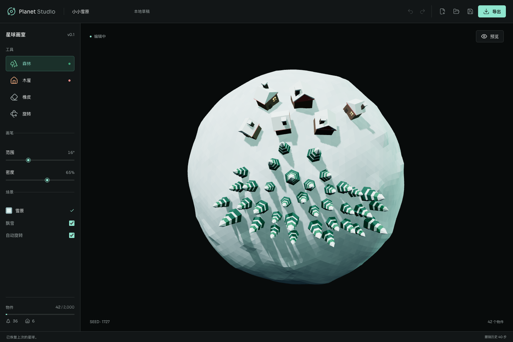

# Planet Studio

在空白的小星球上，用画笔种下一片森林，画出一群木屋。
区域内的物件会自动排列，完成后可以导出为可交互的独立 HTML，嵌入自己的网页。

这是从个人主页中独立出来的星球生成器，目前为 v0.1。
不需要后端、账号或 API Key。



## 已有功能

- 空白雪原星球，森林、木屋、橡皮和旋转工具。
- 球面区域绘制，可调画笔范围和密度，自动调整物件朝向、大小和间距。
- 按完整笔画撤销、重做；中断绘制时回滚未完成的笔画。
- 本地草稿恢复，JSON 项目导入和保存。
- 实时预览、飘雪、自动旋转和暂停，支持减少动态效果的系统设置。
- 导出包含场景数据及 Three.js 运行时的单文件 HTML，可离线打开。
- 生成 iframe 嵌入代码，适配桌面和手机。

## 本地运行

使用 Node.js 24 或更新版本：

```sh
npm ci
npm run dev
```

打开终端显示的本地地址，首页就是编辑器。

```sh
npm test
npm run build
npm run preview
```

生产文件位于 `dist/`，可以部署到静态网页托管服务。资源使用相对路径，
也可以部署在子目录中。

## 编辑与导出

选择森林或木屋工具，在球面上拖动画笔。切换到旋转工具后再拖动星球，
绘制时不会同时旋转。

画布获得焦点后，方向键旋转、Enter 盖章、Escape 取消当前笔画。
在文本输入框之外，Cmd/Ctrl+Z 撤销，Cmd/Ctrl+Shift+Z 重做。

JSON 用来保存可继续编辑的项目，保留物件的最终位置、朝向、尺寸和场景设置。
本地恢复依赖浏览器存储，重要作品请主动下载 JSON。

HTML 用来展示和分享。下载后可以直接离线打开，也可以上传到网站，
再在导出窗口填入实际文件路径并复制 iframe 代码。例如：

```html
<iframe
  src="./my-planet.html"
  title="我的小星球"
  loading="lazy"
  style="width:100%;height:500px;border:0"
></iframe>
```

导出的文件不依赖 CDN 或编辑器服务器。宿主网站需要允许 iframe，
严格的内容安全策略也可能需要允许文件中的内联脚本。

## 当前限制

- 最多 2,000 个物件，40 步撤销历史，导入文件不超过 2 MB。
- 当前只有雪原、树木和木屋，不包含地形雕刻、道路、河流或自定义模型。
- 需要支持 WebGL 2 的浏览器。
- 没有云同步或多人协作，HTML 展示文件不能代替 JSON 编辑项目。
- Three.js 和离线导出运行时会产生较大的构建包，构建时可能出现体积警告。

## 代码结构

```text
prototype/
  index.html          编辑器入口
  vite.config.js      构建与离线播放器打包
  studio/
    model.js          球面采样、排列、项目校验与撤销历史
    scene.js          编辑器和播放器共享的 Three.js 场景
    main.js           编辑器交互与草稿恢复
    player.js         独立播放器
    export.js         HTML 导出与嵌入代码
    style.css         响应式界面
tests/
  studio-model.test.js
  studio-export.test.js
```

`npm test` 包含 18 项模型和导出安全测试。树木、木屋和星球由代码生成，
不依赖外部模型素材。界面使用 Lucide 图标与 Sora 字体；
依赖的许可证仍分别适用，HTML 导出保留 Three.js 的 MIT 许可声明。

## 许可证

此仓库目前公开可见，尚未为项目自身指定开源许可证。
