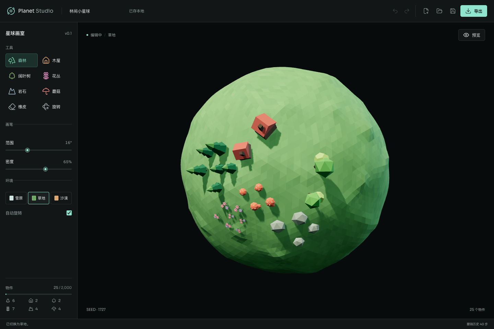

<div align="center">

# Planet Studio

**用画笔，创造属于你的小小世界。**

一个可视化的 3D 星球编辑器，让想象变成低多边形风格的微缩世界。<br>
种下一片森林，画出一座村落，再把整颗星球带到你的网页。

[English](README.md) · **简体中文**

[在线体验](https://snowman1727.github.io/planet-studio/) · [功能亮点](#功能亮点) · [快速开始](#快速开始) · [导出与嵌入](#导出与嵌入)

</div>



## 从一笔开始，创造一个世界

Planet Studio 让你用画笔，把空白的球体变成自己的微缩世界。
不必逐个摆放树木和木屋：在球面上画出一片区域，编辑器就会自动排列物件，
调整它们的大小、朝向和间距，让它们自然地贴合星球表面。

你可以创造白雪覆盖的森林、绿意盎然的小天地，或沙漠中的聚落。
切换环境时保留原有布局，完成后导出可交互的星球，
用于个人网站、作品集，或任何有趣的创意实验。

## 功能亮点

| | 你可以创造什么 |
| --- | --- |
| **区域画笔** | 松林、木屋、阔叶树、花丛、岩石、蘑菇六种画笔。调整范围与密度，用笔触组织每一片区域。 |
| **示例模板** | 从林间花园、山坡村落或沙丘驿站开始创作；每个物件都能继续编辑。 |
| **三种环境** | 在雪原、草地、沙漠之间切换。地表、植被配色和光照随之改变，已有物件保持原位。 |
| **低多边形世界** | 程序化生成的几何模型带来统一的微缩美感，雪原环境还会呈现树冠与屋顶积雪。 |
| **可继续编辑** | 按完整笔画撤销、重做，擦除区域，恢复本地草稿，保存与导入 JSON 项目。 |
| **按类型擦除** | 清理区域内的全部物件，或只擦除松林、木屋、阔叶树、花丛、岩石、蘑菇中的一种，其他类型保持原样。 |
| **单个物件编辑** | 点选物件后沿球面拖动，或精确调整坐标、朝向和大小；安全间距与整次撤销让微调更可控。 |
| **物件锁定** | 锁定选中的景物，防止移动、缩放、删除和擦除；继续在周围绘制，锁定状态随作品保存。 |
| **本地作品库** | 在浏览器内保存多个星球，随时打开、重命名、复制或删除；删除前需确认。 |
| **实时展示** | 旋转星球、预览动画，在雪原中开启飘雪；动态效果尊重系统的减少动态效果设置。 |
| **视角收藏** | 每颗星球最多收藏 8 个具名视角，在编辑器或独立播放器中随时切换。 |
| **把作品带走** | 下载 1024/2048 像素正方形 PNG，选择透明或深色背景；也可导出独立、可交互的 HTML，离线打开或嵌入网页。 |

## 创作你的星球

1. **从空白星球或模板开始。** 点击顶部的模板按钮，选择森林、村落或沙漠构图；替换未保存的作品前会询问确认。也可以从空白球体开始，选择雪原、草地或沙漠环境。
2. **用画笔铺开景物。** 选择画笔，调整范围和密度，在球面上拖动；切换旋转工具，继续创作另一面。
3. **打磨画面。** 混合不同画笔、擦除区域，或撤销、重做笔画。选中橡皮后，通过「擦除对象」选择全部或一种物件；切换目标会取消未完成的笔画，已完成的一笔可整体撤销。目标是临时工具设置，不写入作品存档。切换环境不会打乱已有布局。
4. **保存与分享。** 存入本地作品库或下载 JSON，方便以后继续编辑；导出 HTML，把完成的星球展示出来。

切换「选择」工具后，点击物件并沿球面拖动，金色轮廓会标出它的占地。
内联编辑区提供纬度、经度、朝向和大小（75–120%）；「应用」将表单作为一次
修改提交，垃圾桶按钮删除所选物件。每次拖动、应用或删除都只占一步撤销。
目标空间不足时保留上一个安全位置，拖到球体外也不会让物件悬空。
Escape、导航接管或手势取消会还原未完成的整次拖动。
最终位置、朝向和大小保留在 JSON、草稿、作品库与离线 HTML 中，
选择状态仅属于编辑器；未修改的输入项不会损失存档精度。
已导入的重叠物件仍可旋转或缩小，不必先挪走。

在选择面板勾选「锁定物件」即可保护所选景物。锁定后仍可选中，
但位置、朝向、大小和删除控件禁用；橡皮会跳过它，画笔仍尊重它的占地。
取消勾选后恢复编辑。每次锁定或解锁独占一步撤销；撤销、重做会有意恢复
此前的锁定状态。锁定随 JSON、草稿、作品库和离线 HTML 保留，
旧作品默认未锁定。请使用当前编辑器重新保存，旧版本可能丢弃这个可选字段。
新建或打开另一作品仍会替换整个项目。

编辑器适配桌面和手机。手机端可以滚动底部工具区，使用全部画笔和环境设置。

## 快速开始

需要 **Node.js 24 或更新版本**，以及支持 **WebGL 2** 的浏览器。

```sh
git clone https://github.com/Snowman1727/planet-studio.git
cd planet-studio
npm ci
npm run dev
```

打开终端显示的本地地址，即可进入编辑器。
通过编辑器顶部的语言选择器切换简体中文与英文，浏览器会记住你的选择，
导出的独立 HTML 也使用当前语言。切换语言不会改变星球内容或作品名称。

## 导出与嵌入

### 保留可编辑的作品

保存为 **JSON**，保留物件、位置、朝向、尺寸、环境、当前视角与视角收藏，
以后导入就能继续创作。

点击顶部作品库图标管理本地作品。“保存作品”更新本次打开的作品，
“另存为新作品”创建独立存档。作品库需要主动保存，与自动恢复草稿分开。
刷新后恢复的草稿会另存为新作品，不会悄悄覆盖已有作品；
重命名或删除存档不会丢弃画布上尚未保存的修改。

作品库和草稿仅属于当前浏览器与站点，不跟随账号或跨设备同步。
清理站点数据会移除它们；隐私浏览或容量限制可能导致无法保存。
失败时保留已有存档并提示备份。需要长期保留或转移设备的作品请下载 JSON。
作品库写入使用 Web Locks 防止多标签页互相覆盖，需要支持该能力的浏览器，
并通过 HTTPS 或 localhost 访问。无法安全加锁时仍可打开作品、导出 JSON，
但不会写入作品库。

### 把小世界放进网页

导出 **HTML**，获得包含场景数据与 Three.js 运行时的独立播放器。
文件可以直接离线打开，也可以上传到网站，再通过 iframe 嵌入：

```html
<iframe
  src="./my-planet.html"
  title="我的微缩星球"
  loading="lazy"
  style="width:100%;height:500px;border:0"
></iframe>
```

将 `src` 替换为导出文件的实际路径。也可以在编辑器的导出窗口填写路径，
直接生成嵌入代码。

播放器不依赖 CDN，也不需要连接编辑器服务器。宿主页面需要允许 iframe；
严格的内容安全策略也可能需要允许导出文件中的内联脚本。
HTML 用于展示，不能替代可继续编辑的 JSON 项目。
如果作品收藏了视角，播放器会显示切换视角的菜单。

### 保存一张图片

在导出窗口选择 **PNG**，将尺寸设为 **1024 × 1024** 或 **2048 × 2048**，
即可下载快照。默认使用透明背景，关闭后使用编辑器的深色背景。
图片保留当前显示的朝向，自动将星球及装饰物完整收进正方形画面，
不包含工具栏、画笔轮廓、星空或飘雪。导出不会改变布局、存档视角或撤销历史。

## 操作方式

| 操作 | 控制方式 |
| --- | --- |
| 绘制或擦除 | 选择对应画笔，在球面上拖动 |
| 打开示例模板 | 点击顶部工具栏的模板图标，再选择一颗星球 |
| 管理本地作品 | 点击顶部工具栏的作品库图标 |
| 旋转 | 选择旋转工具后拖动 |
| 键盘旋转 | 画布获得焦点后使用方向键 |
| 选择 / 移动物件 | 选择工具中，点击 / 拖动物件 |
| 键盘编辑物件 | 选择模式下，画布按 Enter 选中中央物件；Tab 到坐标、朝向、大小输入框，再应用 |
| 删除所选物件 | 垃圾桶按钮，或选择模式下画布获得焦点后按 Delete / Backspace |
| 缩放 | 画布上滚轮、双指捏合，或使用缩放按钮 |
| 键盘缩放 / 重置 | 画布获得焦点后按 + / - / 0；点击百分比也可重置 |
| 收藏与切换视角 | 点击预览旁的书签按钮，为当前视角命名；在列表中跳转或删除 |
| 画笔盖章 | 画笔模式中，画布获得焦点后按 Enter |
| 取消当前笔画或物件拖动 | Escape |
| 撤销 | Cmd/Ctrl + Z |
| 重做 | Cmd/Ctrl + Shift + Z |

缩放范围为 **65%–180%**，随 JSON、本地草稿和 HTML 播放器保留。
滚轮或双指接管时会取消未完成的笔画；双指缩放后抬起一根手指，不会恢复绘制。
缩放不占用撤销历史，PNG 导出仍会自动容纳完整星球。
每个项目最多收藏 **8 个**具名视角，记录方向与缩放；JSON 和本地草稿会保留，
收藏、跳转和删除都不占用笔画撤销历史。

撤销、重做快捷键在文本输入框之外生效。

## 开发指南

使用 **JavaScript**、**Three.js**、**Vite** 和 **Lucide** 构建，
搭配 **Sora** 字体。星球与装饰物件均由代码生成。

```sh
npm test          # 模型、几何范围、存档兼容与导出安全测试
npm run build    # 构建编辑器与独立导出运行时
npm run preview  # 本地预览生产构建
```

构建产物位于 `dist/`。资源采用相对路径，可以部署到静态托管服务的域名根目录
或子目录。Three.js 和独立导出运行时会产生较大的构建包，
构建时可能出现包体积警告。

### 项目结构

```text
prototype/
  index.html           编辑器入口
  vite.config.js       构建与独立播放器打包
  studio/
    catalog.js         画笔占地范围与环境配色
    assets.js          程序化装饰模型
    model.js           排列、校验与笔画历史
    object-edit.js     球面拖动与地理坐标输入
    object-inspector.js 单物件选择与数值编辑
    scene.js           编辑器和播放器共享的渲染器
    main.js            编辑器交互与草稿恢复
    player.js          独立播放器交互
    export.js          HTML 导出与嵌入代码
    style.css          响应式编辑器样式
tests/                 模型、几何与导出测试
```

## 能力范围与兼容性

- 最多 **2,000 个物件**、**40 步撤销历史**，单次导入的 JSON 不超过 **2 MB**。
- 环境作用于整颗星球，暂不支持在同一星球上绘制多种地貌。
- 尚未实现地形雕刻、道路、河流与自定义模型导入。
- 不包含云同步与多人协作。
- 项目保存为格式版本 **2**。导入版本 **1** 时，保留原有物件与视角，
  并读取为雪原环境；旧版编辑器无法读取新版格式。
- `view.zoom` 为格式版本 2 的可选字段；没有此字段的版本 1/2 存档按 100%
  打开，显式无效值会被拒绝。较旧的版本 2 编辑器再次保存时可能丢弃缩放。
- `bookmarks` 为格式版本 2 的可选列表；旧版 1/2 存档按空列表打开。
  无效名称、镜头数据或超过 8 项的列表会被拒绝。
- 飘雪偏好在切换环境时保留，切回雪原后生效。

## 参与贡献

欢迎提交问题反馈、创意建议与 Pull Request。反馈问题时，请提供浏览器信息、
复现步骤，以及尽可能精简、移除私人内容后的 JSON 示例。

较大的改动请先通过 Issue 讨论方案。贡献时请保留已有项目兼容性、
确定性的物件排列和离线导出能力，并在提交 Pull Request 前运行测试与生产构建。

### 每日功能路线图

[30 天功能计划](DAILY_PLAN.md) 列出了每日新增能力和验收标准，
[交付进度](docs/daily-progress.json) 记录真正完成上线的功能。
规划中的功能不代表当前已经具备的能力。

## 许可证

[MIT](LICENSE) · Copyright (c) 2026 Snowman1727。

第三方依赖与字体遵循各自的许可证。
导出的 HTML 保留 Planet Studio 和 Three.js 的 MIT 许可声明。
