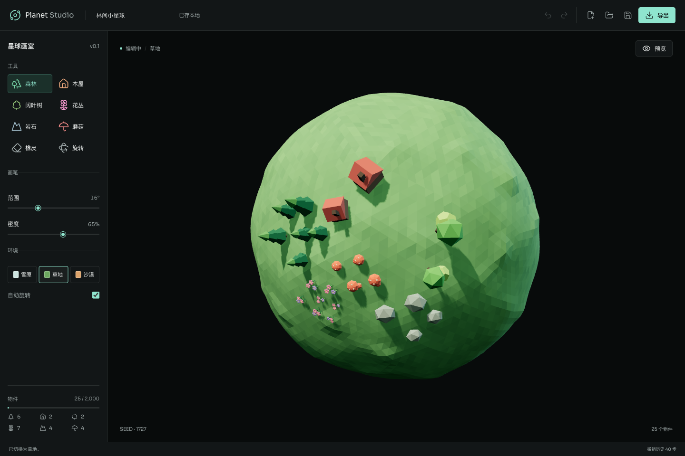

<div align="center">

# Planet Studio

**用画笔，创造属于你的小小世界。**

一个可视化的 3D 星球编辑器，让想象变成低多边形风格的微缩世界。<br>
种下一片森林，画出一座村落，再把整颗星球带到你的网页。

[English](README.md) · **简体中文**

[在线体验](https://snowman1727.github.io/planet-studio/) · [功能亮点](#功能亮点) · [快速开始](#快速开始) · [导出与嵌入](#导出与嵌入)

</div>



## 从一笔开始，创造一个世界

Planet Studio 让你用画笔，把空白的球体变成自己的微缩世界。
不必逐个摆放树木和木屋：在球面上画出一片区域，编辑器就会自动排列物件，
调整它们的大小、朝向和间距，让它们自然地贴合星球表面。

你可以创造白雪覆盖的森林、绿意盎然的小天地，或沙漠中的聚落。
切换环境时保留原有布局，完成后导出可交互的星球，
用于个人网站、作品集，或任何有趣的创意实验。

## 功能亮点

| | 你可以创造什么 |
| --- | --- |
| **区域画笔** | 松林、木屋、阔叶树、花丛、岩石、蘑菇六种画笔。调整范围与密度，用笔触组织每一片区域。 |
| **三种环境** | 在雪原、草地、沙漠之间切换。地表、植被配色和光照随之改变，已有物件保持原位。 |
| **低多边形世界** | 程序化生成的几何模型带来统一的微缩美感，雪原环境还会呈现树冠与屋顶积雪。 |
| **可继续编辑** | 按完整笔画撤销、重做，擦除区域，恢复本地草稿，保存与导入 JSON 项目。 |
| **实时展示** | 旋转星球、预览动画，在雪原中开启飘雪；动态效果尊重系统的减少动态效果设置。 |
| **把作品带走** | 导出独立、可交互的 HTML 文件，离线打开，或嵌入另一个网页。 |

## 创作你的星球

1. **从空白星球开始。** 选择雪原、草地或沙漠作为整体环境。
2. **用画笔铺开景物。** 选择画笔，调整范围和密度，在球面上拖动；切换旋转工具，继续创作另一面。
3. **打磨画面。** 混合不同画笔、擦除区域，或撤销、重做笔画。切换环境不会打乱已有布局。
4. **保存与分享。** 保存 JSON，方便以后继续编辑；导出 HTML，把完成的星球展示出来。

编辑器适配桌面和手机。手机端可以滚动底部工具区，使用全部画笔和环境设置。

## 快速开始

需要 **Node.js 24 或更新版本**，以及支持 **WebGL 2** 的浏览器。

```sh
git clone https://github.com/Snowman1727/planet-studio.git
cd planet-studio
npm ci
npm run dev
```

打开终端显示的本地地址，即可进入编辑器。
通过编辑器顶部的语言选择器切换简体中文与英文，浏览器会记住你的选择，
导出的独立 HTML 也使用当前语言。切换语言不会改变星球内容或作品名称。

## 导出与嵌入

### 保留可编辑的作品

保存为 **JSON**，保留物件、位置、朝向、尺寸、环境与视角，
以后导入就能继续创作。

本地草稿恢复依赖浏览器存储。需要长期保留的作品请下载 JSON，
因为清理浏览器数据也会移除本地草稿。

### 把小世界放进网页

导出 **HTML**，获得包含场景数据与 Three.js 运行时的独立播放器。
文件可以直接离线打开，也可以上传到网站，再通过 iframe 嵌入：

```html
<iframe
  src="./my-planet.html"
  title="我的微缩星球"
  loading="lazy"
  style="width:100%;height:500px;border:0"
></iframe>
```

将 `src` 替换为导出文件的实际路径。也可以在编辑器的导出窗口填写路径，
直接生成嵌入代码。

播放器不依赖 CDN，也不需要连接编辑器服务器。宿主页面需要允许 iframe；
严格的内容安全策略也可能需要允许导出文件中的内联脚本。
HTML 用于展示，不能替代可继续编辑的 JSON 项目。

## 操作方式

| 操作 | 控制方式 |
| --- | --- |
| 绘制或擦除 | 选择对应画笔，在球面上拖动 |
| 旋转 | 选择旋转工具后拖动 |
| 键盘旋转 | 画布获得焦点后使用方向键 |
| 画笔盖章 | 画布获得焦点后按 Enter |
| 取消当前笔画 | Escape |
| 撤销 | Cmd/Ctrl + Z |
| 重做 | Cmd/Ctrl + Shift + Z |

撤销、重做快捷键在文本输入框之外生效。

## 开发指南

使用 **JavaScript**、**Three.js**、**Vite** 和 **Lucide** 构建，
搭配 **Sora** 字体。星球与装饰物件均由代码生成。

```sh
npm test          # 模型、几何范围、存档兼容与导出安全测试
npm run build    # 构建编辑器与独立导出运行时
npm run preview  # 本地预览生产构建
```

构建产物位于 `dist/`。资源采用相对路径，可以部署到静态托管服务的域名根目录
或子目录。Three.js 和独立导出运行时会产生较大的构建包，
构建时可能出现包体积警告。

### 项目结构

```text
prototype/
  index.html           编辑器入口
  vite.config.js       构建与独立播放器打包
  studio/
    catalog.js         画笔占地范围与环境配色
    assets.js          程序化装饰模型
    model.js           排列、校验与笔画历史
    scene.js           编辑器和播放器共享的渲染器
    main.js            编辑器交互与草稿恢复
    player.js          独立播放器交互
    export.js          HTML 导出与嵌入代码
    style.css          响应式编辑器样式
tests/                 模型、几何与导出测试
```

## 能力范围与兼容性

- 最多 **2,000 个物件**、**40 步撤销历史**，单次导入的 JSON 不超过 **2 MB**。
- 环境作用于整颗星球，暂不支持在同一星球上绘制多种地貌。
- 尚未实现地形雕刻、道路、河流与自定义模型导入。
- 不包含云同步与多人协作。
- 项目保存为格式版本 **2**。导入版本 **1** 时，保留原有物件与视角，
  并读取为雪原环境；旧版编辑器无法读取新版格式。
- 飘雪偏好在切换环境时保留，切回雪原后生效。

## 参与贡献

欢迎提交问题反馈、创意建议与 Pull Request。反馈问题时，请提供浏览器信息、
复现步骤，以及尽可能精简、移除私人内容后的 JSON 示例。

较大的改动请先通过 Issue 讨论方案。贡献时请保留已有项目兼容性、
确定性的物件排列和离线导出能力，并在提交 Pull Request 前运行测试与生产构建。

### 每日功能路线图

[30 天功能计划](DAILY_PLAN.md) 列出了每日新增能力和验收标准，
[交付进度](docs/daily-progress.json) 记录真正完成上线的功能。
规划中的功能不代表当前已经具备的能力。

## 许可证

[MIT](LICENSE) · Copyright (c) 2026 Snowman1727。

第三方依赖与字体遵循各自的许可证。
导出的 HTML 保留 Planet Studio 和 Three.js 的 MIT 许可声明。
